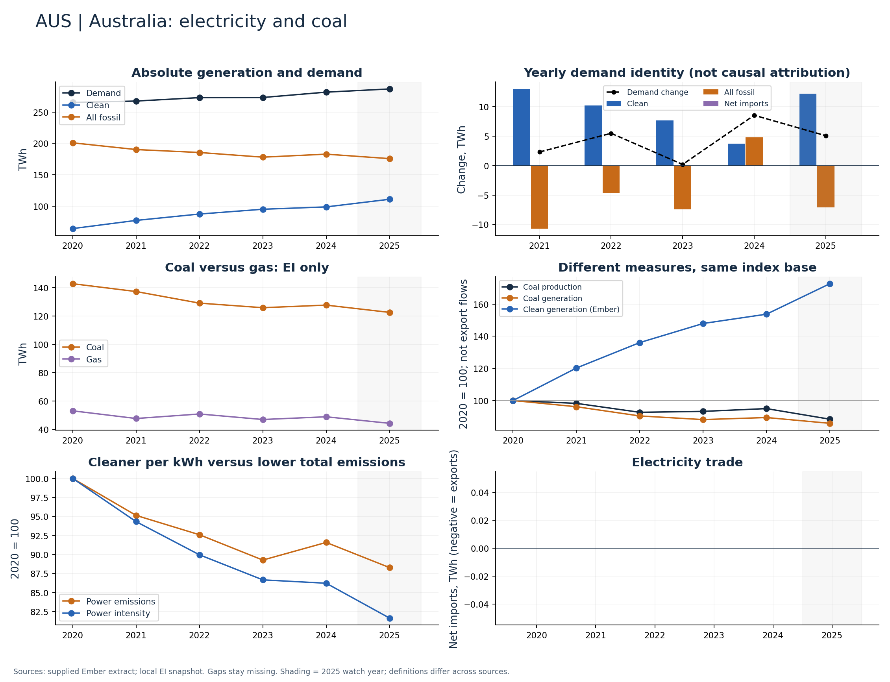

# Australia (AUS)

Clean generation grew and coal generation fell through 2024.

Available Ember years: 2020,2021,2022,2023,2024,2025. Core research market: True.

Clean generation change: +53.7%; coal generation change: -10.6%; demand change: +6.2% (2020–2024).

Contrast domestic generation with production indices. Domestic coal decline cannot establish export-producer decline.

## Recommended charts

- Annual clean/fossil additions plus demand change and net imports (Ember accounting identity).
- Power emissions and carbon intensity in separate panels or clearly labelled 2020 indices.
- Coal and gas generation (EI only); clean share separately (Ember).
- Coal production and generation indices; do not infer exports or compare Mt directly with TWh.

## Evidence

|    year |   demand_twh |   clean_generation_twh |   fossil_generation_twh |   ei_coal_generation_twh |   net_imports_twh |   power_emissions_mtco2e |
|--------:|-------------:|-----------------------:|------------------------:|-------------------------:|------------------:|-------------------------:|
| 2020.00 |       265.15 |                  64.28 |                  200.87 |                   142.93 |              0.00 |                   170.35 |
| 2021.00 |       267.45 |                  77.27 |                  190.18 |                   137.40 |              0.00 |                   162.08 |
| 2022.00 |       272.92 |                  87.44 |                  185.48 |                   129.21 |              0.00 |                   157.75 |
| 2023.00 |       273.11 |                  95.07 |                  178.04 |                   125.97 |              0.00 |                   152.08 |
| 2024.00 |       281.64 |                  98.79 |                  182.85 |                   127.80 |              0.00 |                   156.03 |
| 2025.00 |       286.70 |                 110.97 |                  175.73 |                   122.66 |              0.00 |                   150.40 |

Sources: supplied Ember extract; local Energy Institute snapshot, joined by normalized country/year. Coal and all-fossil are different measures. No causal or security-return claim follows from these series alone.

