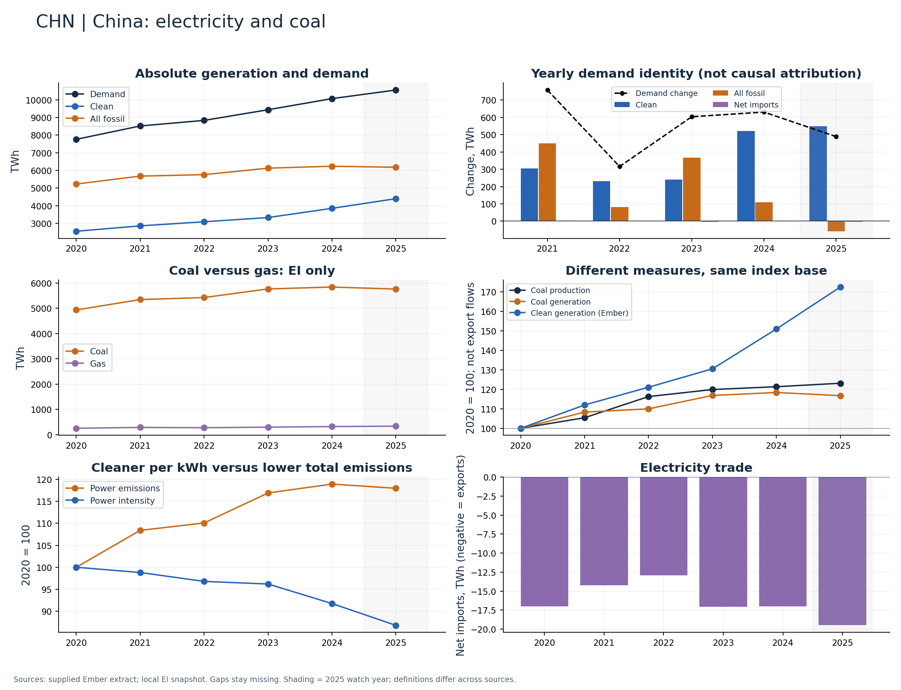

# China (CHN)

Clean and coal generation both expanded through 2024; 2025 is a separate watch point.

Available Ember years: 2020,2021,2022,2023,2024,2025. Core research market: True.

Clean generation change: +50.9%; coal generation change: +18.4%; demand change: +29.7% (2020–2024).

Show absolute TWh additions alongside shares. A clean-share gain does not establish falling coal volumes.

## Recommended charts

- Annual clean/fossil additions plus demand change and net imports (Ember accounting identity).
- Power emissions and carbon intensity in separate panels or clearly labelled 2020 indices.
- Coal and gas generation (EI only); clean share separately (Ember).
- Coal production and generation indices; do not infer exports or compare Mt directly with TWh.

## Evidence

|    year |   demand_twh |   clean_generation_twh |   fossil_generation_twh |   ei_coal_generation_twh |   net_imports_twh |   power_emissions_mtco2e |
|--------:|-------------:|-----------------------:|------------------------:|-------------------------:|------------------:|-------------------------:|
| 2020.00 |      7762.03 |                2551.21 |                 5227.86 |                  4930.98 |            -17.04 |                  4717.20 |
| 2021.00 |      8520.02 |                2856.30 |                 5677.96 |                  5341.05 |            -14.24 |                  5113.33 |
| 2022.00 |      8835.76 |                3088.44 |                 5760.27 |                  5422.28 |            -12.95 |                  5192.98 |
| 2023.00 |      9439.37 |                3328.94 |                 6127.51 |                  5761.32 |            -17.08 |                  5515.45 |
| 2024.00 |     10069.88 |                3849.68 |                 6237.20 |                  5836.35 |            -17.00 |                  5610.99 |
| 2025.00 |     10558.25 |                4398.80 |                 6178.91 |                  5755.91 |            -19.46 |                  5565.88 |

Sources: supplied Ember extract; local Energy Institute snapshot, joined by normalized country/year. Coal and all-fossil are different measures. No causal or security-return claim follows from these series alone.

