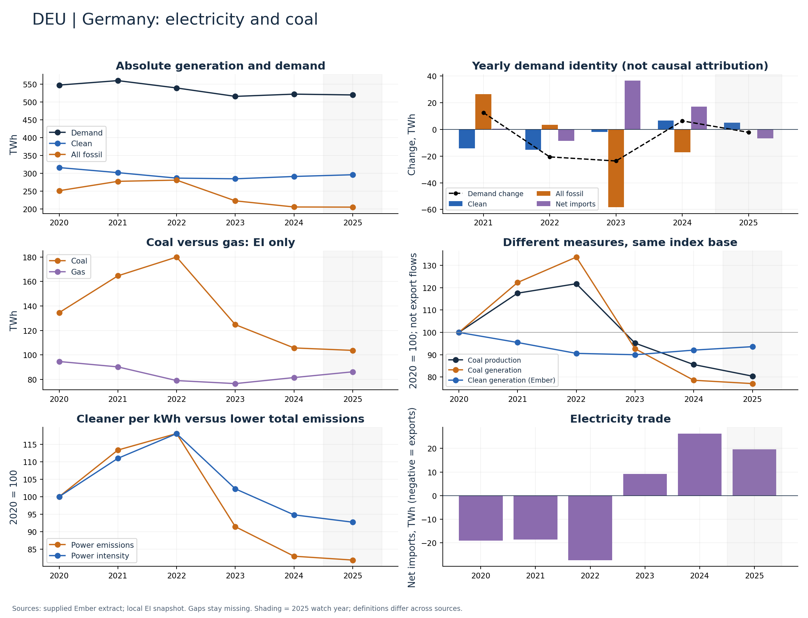

# Germany (DEU)

Coal, clean generation and demand all declined over 2020–2024.

Available Ember years: 2020,2021,2022,2023,2024,2025. Core research market: True.

Clean generation change: -7.9%; coal generation change: -21.4%; demand change: -4.6% (2020–2024).

Prioritize the demand identity and net-import panel. Clean-share improvement alone cannot establish rising clean output or domestic coal replacement.

## Recommended charts

- Demand-contraction panel: do not report a clean-growth/demand-growth ratio when demand fell.
- Net imports as a share of demand: trade is material (>5% absolute in 2024).
- Annual clean/fossil additions plus demand change and net imports (Ember accounting identity).
- Power emissions and carbon intensity in separate panels or clearly labelled 2020 indices.
- Coal and gas generation (EI only); clean share separately (Ember).
- Coal production and generation indices; do not infer exports or compare Mt directly with TWh.

## Evidence

|    year |   demand_twh |   clean_generation_twh |   fossil_generation_twh |   ei_coal_generation_twh |   net_imports_twh |   power_emissions_mtco2e |
|--------:|-------------:|-----------------------:|------------------------:|-------------------------:|------------------:|-------------------------:|
| 2020.00 |       547.72 |                 315.87 |                  250.88 |                   134.59 |            -19.03 |                   201.54 |
| 2021.00 |       560.25 |                 301.63 |                  277.20 |                   164.65 |            -18.58 |                   228.43 |
| 2022.00 |       539.62 |                 286.25 |                  280.63 |                   179.95 |            -27.26 |                   237.94 |
| 2023.00 |       515.94 |                 284.32 |                  222.40 |                   124.79 |              9.22 |                   184.24 |
| 2024.00 |       522.26 |                 290.86 |                  205.13 |                   105.77 |             26.27 |                   167.21 |
| 2025.00 |       520.01 |                 295.74 |                  204.73 |                   103.76 |             19.54 |                   164.98 |

Sources: supplied Ember extract; local Energy Institute snapshot, joined by normalized country/year. Coal and all-fossil are different measures. No causal or security-return claim follows from these series alone.

