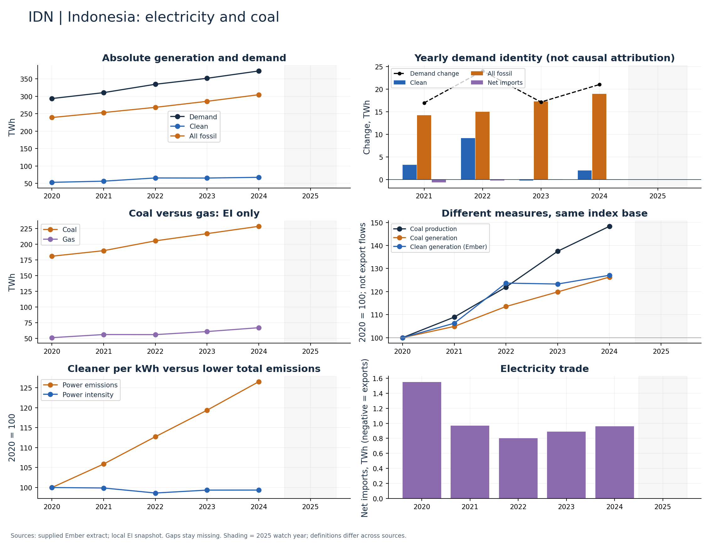

# Indonesia (IDN)

Coal and clean generation grew together through 2024.

Available Ember years: 2020,2021,2022,2023,2024. Core research market: True.

Clean generation change: +27.1%; coal generation change: +26.3%; demand change: +27.0% (2020–2024).

Index coal production and coal generation separately. Their divergence does not identify export flows. Ember has no 2025 row here; do not backfill it.

## Recommended charts

- Annual clean/fossil additions plus demand change and net imports (Ember accounting identity).
- Power emissions and carbon intensity in separate panels or clearly labelled 2020 indices.
- Coal and gas generation (EI only); clean share separately (Ember).
- Coal production and generation indices; do not infer exports or compare Mt directly with TWh.

## Evidence

|    year |   demand_twh |   clean_generation_twh |   fossil_generation_twh |   ei_coal_generation_twh |   net_imports_twh |   power_emissions_mtco2e |
|--------:|-------------:|-----------------------:|------------------------:|-------------------------:|------------------:|-------------------------:|
| 2020.00 |       293.37 |                  52.89 |                  238.93 |                   180.87 |              1.55 |                   200.03 |
| 2021.00 |       310.33 |                  56.20 |                  253.16 |                   189.68 |              0.97 |                   211.81 |
| 2022.00 |       334.34 |                  65.41 |                  268.13 |                   205.31 |              0.80 |                   225.49 |
| 2023.00 |       351.49 |                  65.20 |                  285.40 |                   216.78 |              0.89 |                   238.77 |
| 2024.00 |       372.50 |                  67.21 |                  304.33 |                   228.43 |              0.96 |                   253.06 |

Sources: supplied Ember extract; local Energy Institute snapshot, joined by normalized country/year. Coal and all-fossil are different measures. No causal or security-return claim follows from these series alone.

