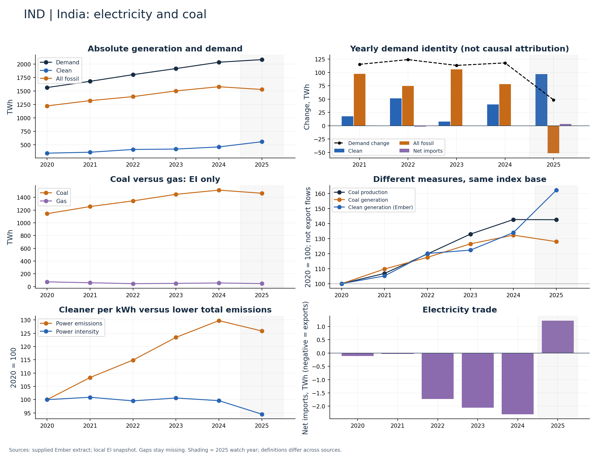

# India (IND)

Demand growth accompanied increases in both clean and coal generation through 2024.

Available Ember years: 2020,2021,2022,2023,2024,2025. Core research market: True.

Clean generation change: +34.0%; coal generation change: +32.3%; demand change: +30.1% (2020–2024).

Compare demand and clean additions in TWh; monitor whether the latest coal decline persists. Do not label percentage-growth comparisons as absolute additions.

## Recommended charts

- Annual clean/fossil additions plus demand change and net imports (Ember accounting identity).
- Power emissions and carbon intensity in separate panels or clearly labelled 2020 indices.
- Coal and gas generation (EI only); clean share separately (Ember).
- Coal production and generation indices; do not infer exports or compare Mt directly with TWh.

## Evidence

|    year |   demand_twh |   clean_generation_twh |   fossil_generation_twh |   ei_coal_generation_twh |   net_imports_twh |   power_emissions_mtco2e |
|--------:|-------------:|-----------------------:|------------------------:|-------------------------:|------------------:|-------------------------:|
| 2020.00 |      1563.32 |                 341.77 |                 1221.66 |                  1143.78 |             -0.11 |                  1109.05 |
| 2021.00 |      1678.69 |                 359.37 |                 1319.35 |                  1255.56 |             -0.03 |                  1201.38 |
| 2022.00 |      1802.88 |                 410.54 |                 1394.07 |                  1344.42 |             -1.73 |                  1274.18 |
| 2023.00 |      1916.20 |                 418.17 |                 1500.09 |                  1447.39 |             -2.06 |                  1369.09 |
| 2024.00 |      2034.22 |                 458.09 |                 1578.43 |                  1513.52 |             -2.30 |                  1439.15 |
| 2025.00 |      2082.82 |                 554.81 |                 1526.79 |                  1464.17 |              1.22 |                  1395.81 |

Sources: supplied Ember extract; local Energy Institute snapshot, joined by normalized country/year. Coal and all-fossil are different measures. No causal or security-return claim follows from these series alone.

