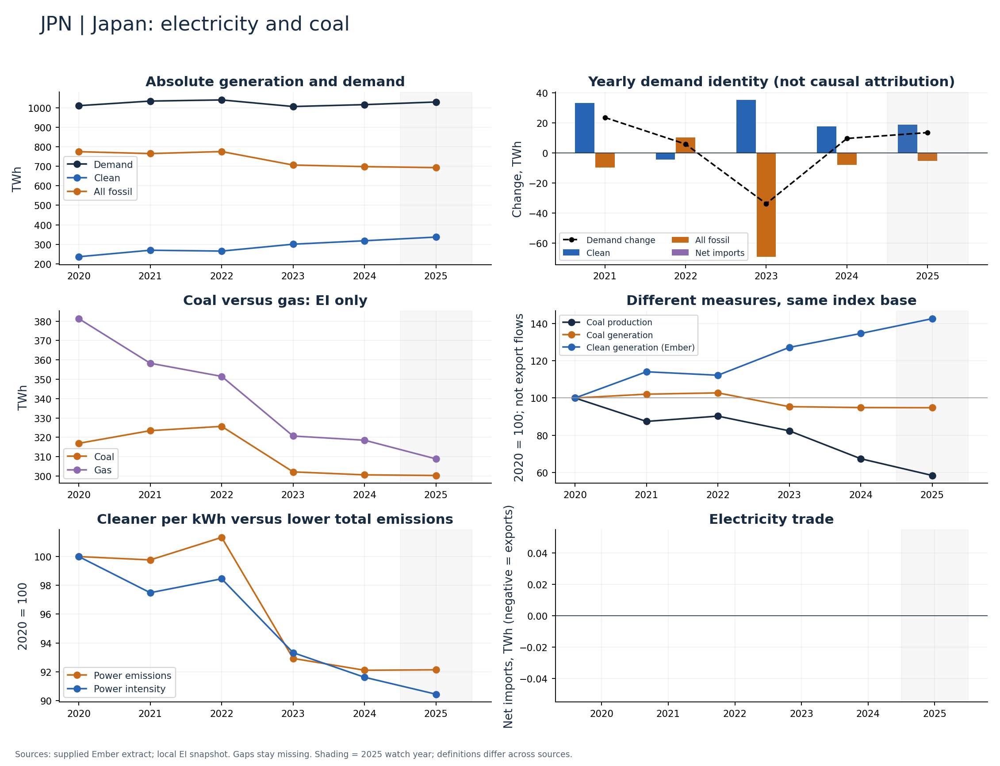

# Japan (JPN)

Clean generation grew while coal and total fossil generation declined through 2024.

Available Ember years: 2020,2021,2022,2023,2024,2025. Core research market: True.

Clean generation change: +34.7%; coal generation change: -5.1%; demand change: +0.5% (2020–2024).

Compare coal and gas on an EI-only basis; show clean-generation growth against nearly flat demand. Technology attribution requires a separate fuel-level check.

## Recommended charts

- Annual clean/fossil additions plus demand change and net imports (Ember accounting identity).
- Power emissions and carbon intensity in separate panels or clearly labelled 2020 indices.
- Coal and gas generation (EI only); clean share separately (Ember).
- Coal production and generation indices; do not infer exports or compare Mt directly with TWh.

## Evidence

|    year |   demand_twh |   clean_generation_twh |   fossil_generation_twh |   ei_coal_generation_twh |   net_imports_twh |   power_emissions_mtco2e |
|--------:|-------------:|-----------------------:|------------------------:|-------------------------:|------------------:|-------------------------:|
| 2020.00 |      1011.03 |                 236.03 |                  775.00 |                   316.89 |              0.00 |                   533.67 |
| 2021.00 |      1034.67 |                 269.36 |                  765.31 |                   323.43 |              0.00 |                   532.43 |
| 2022.00 |      1040.57 |                 264.96 |                  775.61 |                   325.64 |              0.00 |                   540.78 |
| 2023.00 |      1006.73 |                 300.32 |                  706.41 |                   302.12 |              0.00 |                   495.91 |
| 2024.00 |      1016.39 |                 318.02 |                  698.37 |                   300.58 |              0.00 |                   491.51 |
| 2025.00 |      1029.97 |                 336.82 |                  693.15 |                   300.27 |              0.00 |                   491.68 |

Sources: supplied Ember extract; local Energy Institute snapshot, joined by normalized country/year. Coal and all-fossil are different measures. No causal or security-return claim follows from these series alone.

