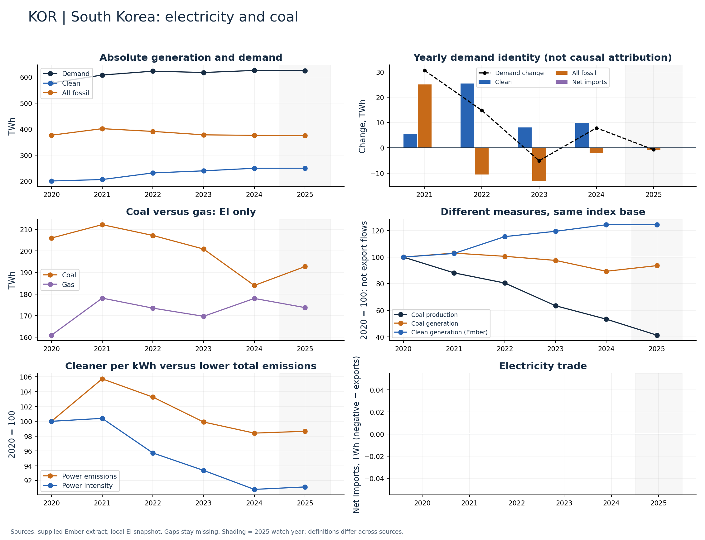

# South Korea (KOR)

Clean generation rose while coal generation fell through 2024.

Available Ember years: 2020,2021,2022,2023,2024,2025. Core research market: False.

Clean generation change: +24.4%; coal generation change: -10.7%; demand change: +8.4% (2020–2024).

Compare EI coal and gas changes and Ember clean additions; determine whether the clean increase exceeds additional demand before claiming substitution.

## Recommended charts

- Annual clean/fossil additions plus demand change and net imports (Ember accounting identity).
- Power emissions and carbon intensity in separate panels or clearly labelled 2020 indices.
- Coal and gas generation (EI only); clean share separately (Ember).
- Coal production and generation indices; do not infer exports or compare Mt directly with TWh.

## Evidence

|    year |   demand_twh |   clean_generation_twh |   fossil_generation_twh |   ei_coal_generation_twh |   net_imports_twh |   power_emissions_mtco2e |
|--------:|-------------:|-----------------------:|------------------------:|-------------------------:|------------------:|-------------------------:|
| 2020.00 |       577.11 |                 200.58 |                  376.53 |                   205.92 |              0.00 |                   264.13 |
| 2021.00 |       607.76 |                 206.11 |                  401.65 |                   212.12 |              0.00 |                   279.27 |
| 2022.00 |       622.59 |                 231.54 |                  391.05 |                   207.11 |              0.00 |                   272.76 |
| 2023.00 |       617.49 |                 239.56 |                  377.93 |                   200.82 |              0.00 |                   263.88 |
| 2024.00 |       625.38 |                 249.47 |                  375.91 |                   183.96 |              0.00 |                   259.92 |
| 2025.00 |       624.66 |                 249.60 |                  375.06 |                   192.71 |              0.00 |                   260.57 |

Sources: supplied Ember extract; local Energy Institute snapshot, joined by normalized country/year. Coal and all-fossil are different measures. No causal or security-return claim follows from these series alone.

