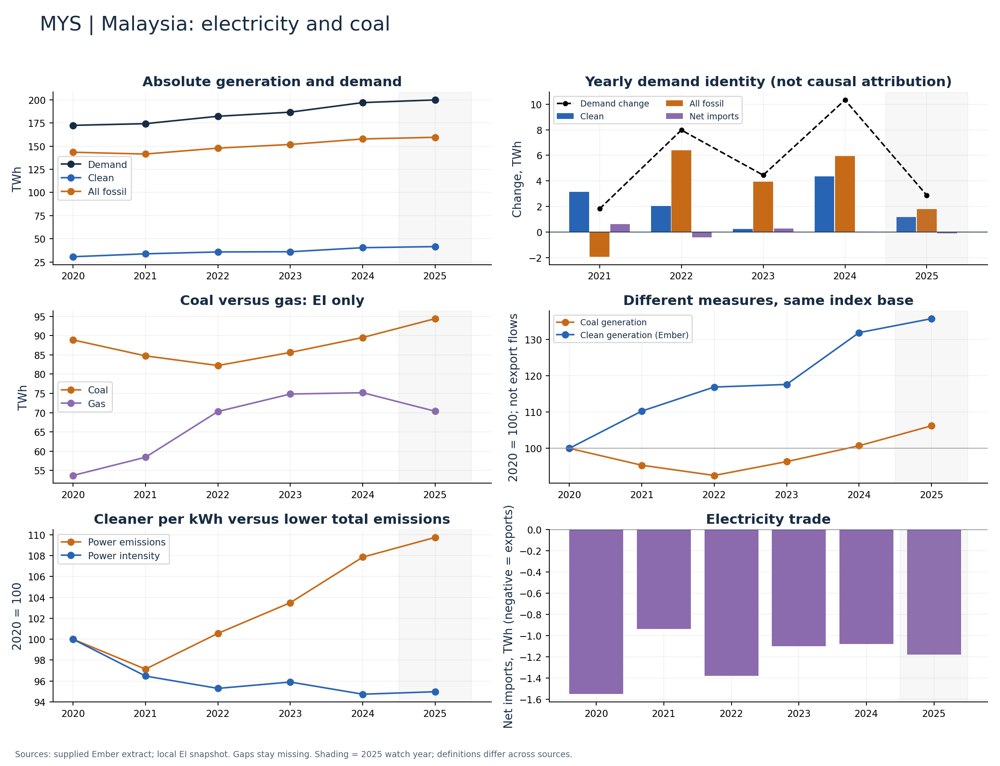

# Malaysia (MYS)

Clean generation rose while coal generation was roughly flat through 2024.

Available Ember years: 2020,2021,2022,2023,2024,2025. Core research market: False.

Clean generation change: +31.9%; coal generation change: +0.7%; demand change: +14.3% (2020–2024).

Show absolute coal output beside its share and demand growth. A flat coal series is materially different from a large decline.

## Recommended charts

- Annual clean/fossil additions plus demand change and net imports (Ember accounting identity).
- Power emissions and carbon intensity in separate panels or clearly labelled 2020 indices.
- Coal and gas generation (EI only); clean share separately (Ember).

## Evidence

|    year |   demand_twh |   clean_generation_twh |   fossil_generation_twh |   ei_coal_generation_twh |   net_imports_twh |   power_emissions_mtco2e |
|--------:|-------------:|-----------------------:|------------------------:|-------------------------:|------------------:|-------------------------:|
| 2020.00 |       172.46 |                  30.59 |                  143.42 |                    88.88 |             -1.55 |                   110.52 |
| 2021.00 |       174.27 |                  33.73 |                  141.48 |                    84.73 |             -0.94 |                   107.36 |
| 2022.00 |       182.25 |                  35.76 |                  147.87 |                    82.22 |             -1.38 |                   111.14 |
| 2023.00 |       186.70 |                  35.98 |                  151.82 |                    85.62 |             -1.10 |                   114.39 |
| 2024.00 |       197.04 |                  40.35 |                  157.77 |                    89.50 |             -1.08 |                   119.21 |
| 2025.00 |       199.91 |                  41.53 |                  159.56 |                    94.39 |             -1.18 |                   121.30 |

Sources: supplied Ember extract; local Energy Institute snapshot, joined by normalized country/year. Coal and all-fossil are different measures. No causal or security-return claim follows from these series alone.

