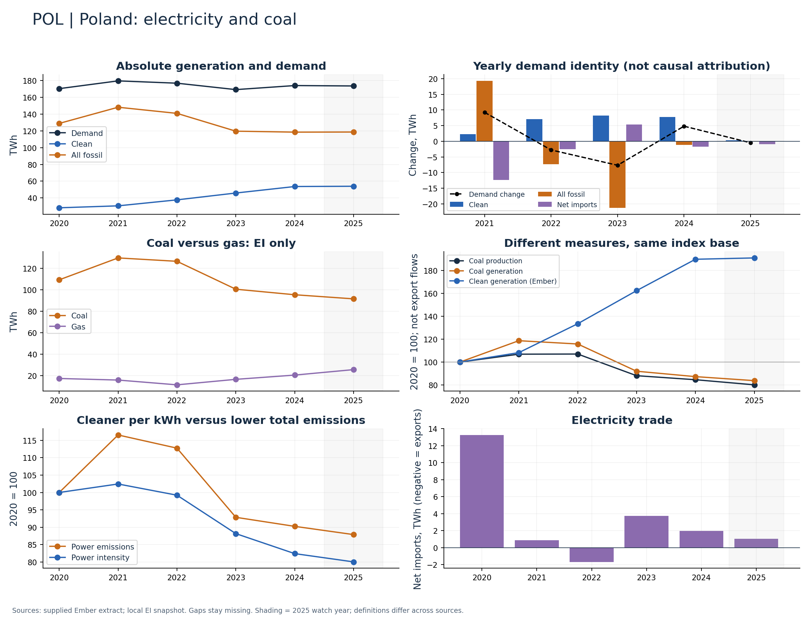

# Poland (POL)

Clean generation grew rapidly from a smaller base while coal generation fell through 2024.

Available Ember years: 2020,2021,2022,2023,2024,2025. Core research market: False.

Clean generation change: +89.9%; coal generation change: -12.7%; demand change: +2.2% (2020–2024).

Pair percentage growth with TWh additions to avoid exaggerating a low-base effect; show remaining coal generation alongside the cleaner mix.

## Recommended charts

- Annual clean/fossil additions plus demand change and net imports (Ember accounting identity).
- Power emissions and carbon intensity in separate panels or clearly labelled 2020 indices.
- Coal and gas generation (EI only); clean share separately (Ember).
- Coal production and generation indices; do not infer exports or compare Mt directly with TWh.

## Evidence

|    year |   demand_twh |   clean_generation_twh |   fossil_generation_twh |   ei_coal_generation_twh |   net_imports_twh |   power_emissions_mtco2e |
|--------:|-------------:|-----------------------:|------------------------:|-------------------------:|------------------:|-------------------------:|
| 2020.00 |       170.42 |                  28.23 |                  128.92 |                   109.37 |             13.27 |                   116.02 |
| 2021.00 |       179.68 |                  30.56 |                  148.23 |                   129.81 |              0.89 |                   135.23 |
| 2022.00 |       176.92 |                  37.69 |                  140.91 |                   126.65 |             -1.68 |                   130.83 |
| 2023.00 |       169.26 |                  45.86 |                  119.66 |                   100.61 |              3.74 |                   107.73 |
| 2024.00 |       174.09 |                  53.61 |                  118.51 |                    95.44 |              1.97 |                   104.71 |
| 2025.00 |       173.62 |                  53.94 |                  118.64 |                    91.61 |              1.04 |                   101.96 |

Sources: supplied Ember extract; local Energy Institute snapshot, joined by normalized country/year. Coal and all-fossil are different measures. No causal or security-return claim follows from these series alone.

