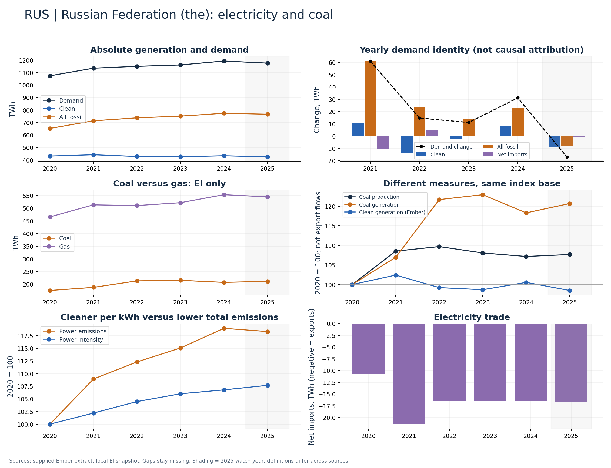

# Russian Federation (the) (RUS)

Coal generation grew while clean generation was nearly flat through 2024.

Available Ember years: 2020,2021,2022,2023,2024,2025. Core research market: True.

Clean generation change: +0.6%; coal generation change: +18.3%; demand change: +11.0% (2020–2024).

Show demand additions and EI coal/gas changes; do not treat a global clean-energy trajectory as uniform across markets.

## Recommended charts

- Annual clean/fossil additions plus demand change and net imports (Ember accounting identity).
- Power emissions and carbon intensity in separate panels or clearly labelled 2020 indices.
- Coal and gas generation (EI only); clean share separately (Ember).
- Coal production and generation indices; do not infer exports or compare Mt directly with TWh.

## Evidence

|    year |   demand_twh |   clean_generation_twh |   fossil_generation_twh |   ei_coal_generation_twh |   net_imports_twh |   power_emissions_mtco2e |
|--------:|-------------:|-----------------------:|------------------------:|-------------------------:|------------------:|-------------------------:|
| 2020.00 |      1074.68 |                 432.16 |                  653.26 |                   174.96 |            -10.74 |                   453.43 |
| 2021.00 |      1135.73 |                 442.63 |                  714.44 |                   187.14 |            -21.34 |                   493.96 |
| 2022.00 |      1150.54 |                 428.81 |                  738.13 |                   212.91 |            -16.40 |                   509.28 |
| 2023.00 |      1161.72 |                 426.48 |                  751.77 |                   215.11 |            -16.53 |                   521.82 |
| 2024.00 |      1192.91 |                 434.57 |                  774.74 |                   206.98 |            -16.40 |                   539.49 |
| 2025.00 |      1176.10 |                 425.63 |                  767.16 |                   211.17 |            -16.69 |                   536.59 |

Sources: supplied Ember extract; local Energy Institute snapshot, joined by normalized country/year. Coal and all-fossil are different measures. No causal or security-return claim follows from these series alone.

