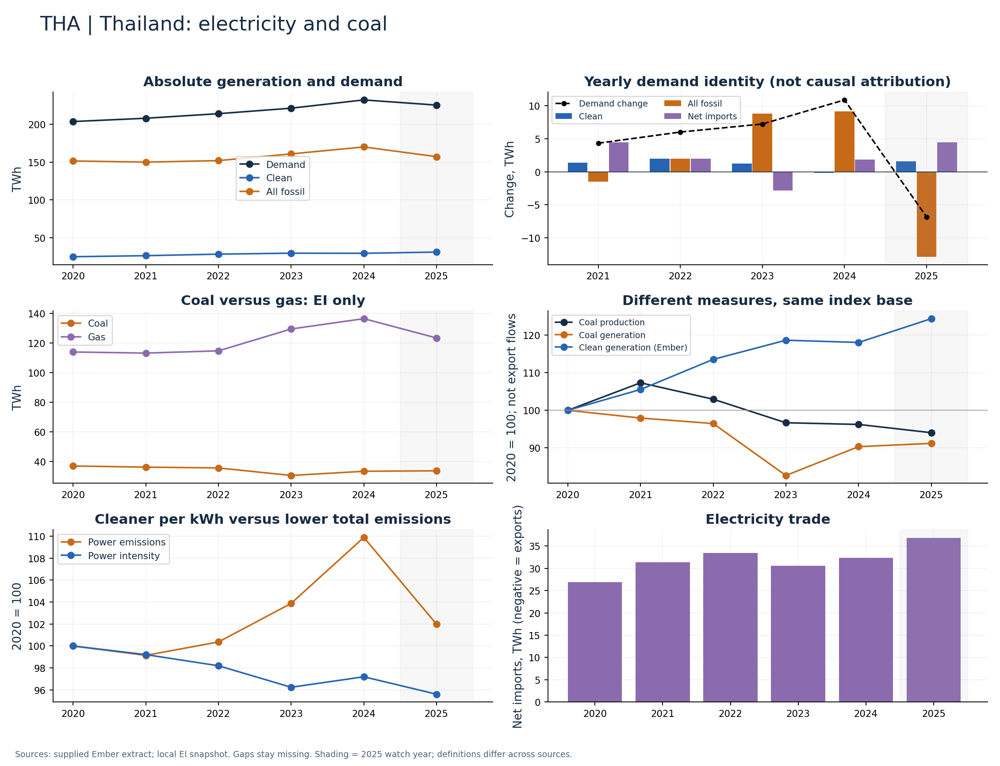

# Thailand (THA)

Clean generation increased while coal generation declined through 2024.

Available Ember years: 2020,2021,2022,2023,2024,2025. Core research market: False.

Clean generation change: +18.1%; coal generation change: -9.7%; demand change: +14.0% (2020–2024).

Prioritize coal versus gas and electricity trade; coal decline alone does not establish falling total fossil dependence.

## Recommended charts

- Net imports as a share of demand: trade is material (>5% absolute in 2024).
- Annual clean/fossil additions plus demand change and net imports (Ember accounting identity).
- Power emissions and carbon intensity in separate panels or clearly labelled 2020 indices.
- Coal and gas generation (EI only); clean share separately (Ember).
- Coal production and generation indices; do not infer exports or compare Mt directly with TWh.

## Evidence

|    year |   demand_twh |   clean_generation_twh |   fossil_generation_twh |   ei_coal_generation_twh |   net_imports_twh |   power_emissions_mtco2e |
|--------:|-------------:|-----------------------:|------------------------:|-------------------------:|------------------:|-------------------------:|
| 2020.00 |       203.41 |                  25.08 |                  151.40 |                    36.82 |             26.93 |                   100.84 |
| 2021.00 |       207.75 |                  26.47 |                  149.89 |                    36.06 |             31.39 |                    99.98 |
| 2022.00 |       213.78 |                  28.48 |                  151.89 |                    35.52 |             33.41 |                   101.21 |
| 2023.00 |       221.03 |                  29.76 |                  160.72 |                    30.43 |             30.55 |                   104.75 |
| 2024.00 |       231.93 |                  29.61 |                  169.91 |                    33.26 |             32.41 |                   110.81 |
| 2025.00 |       225.10 |                  31.20 |                  157.04 |                    33.58 |             36.86 |                   102.84 |

Sources: supplied Ember extract; local Energy Institute snapshot, joined by normalized country/year. Coal and all-fossil are different measures. No causal or security-return claim follows from these series alone.

