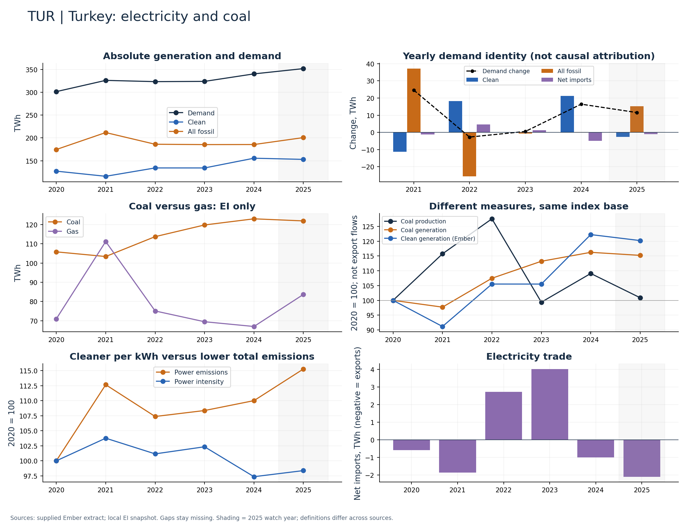

# Turkey (TUR)

Clean generation and coal generation both increased through 2024.

Available Ember years: 2020,2021,2022,2023,2024,2025. Core research market: False.

Clean generation change: +22.2%; coal generation change: +16.2%; demand change: +12.9% (2020–2024).

Compare demand additions, clean additions and coal additions separately. Add production indices only as a different measure, not an export balance.

## Recommended charts

- Annual clean/fossil additions plus demand change and net imports (Ember accounting identity).
- Power emissions and carbon intensity in separate panels or clearly labelled 2020 indices.
- Coal and gas generation (EI only); clean share separately (Ember).
- Coal production and generation indices; do not infer exports or compare Mt directly with TWh.

## Evidence

|    year |   demand_twh |   clean_generation_twh |   fossil_generation_twh |   ei_coal_generation_twh |   net_imports_twh |   power_emissions_mtco2e |
|--------:|-------------:|-----------------------:|------------------------:|-------------------------:|------------------:|-------------------------:|
| 2020.00 |       301.41 |                 127.33 |                  174.67 |                   105.81 |             -0.59 |                   146.04 |
| 2021.00 |       326.03 |                 116.07 |                  211.81 |                   103.38 |             -1.85 |                   164.53 |
| 2022.00 |       323.29 |                 134.35 |                  186.21 |                   113.72 |              2.73 |                   156.81 |
| 2023.00 |       323.81 |                 134.34 |                  185.45 |                   119.80 |              4.02 |                   158.26 |
| 2024.00 |       340.24 |                 155.65 |                  185.58 |                   123.00 |             -0.99 |                   160.66 |
| 2025.00 |       351.77 |                 153.07 |                  200.79 |                   121.91 |             -2.09 |                   168.34 |

Sources: supplied Ember extract; local Energy Institute snapshot, joined by normalized country/year. Coal and all-fossil are different measures. No causal or security-return claim follows from these series alone.

