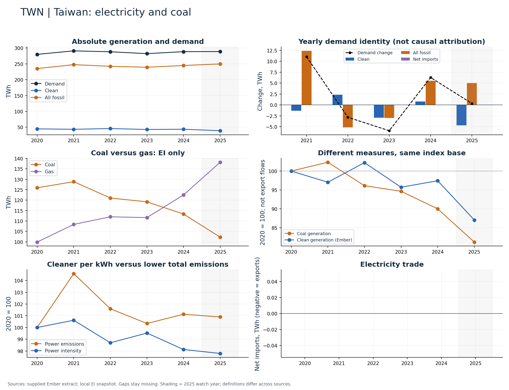

# Taiwan (TWN)

Both clean and coal generation declined through 2024.

Available Ember years: 2020,2021,2022,2023,2024,2025. Core research market: False.

Clean generation change: -2.6%; coal generation change: -10.0%; demand change: +3.1% (2020–2024).

Show gas and demand alongside the clean decline; do not label this pathway as clean-output-led coal replacement.

## Recommended charts

- Annual clean/fossil additions plus demand change and net imports (Ember accounting identity).
- Power emissions and carbon intensity in separate panels or clearly labelled 2020 indices.
- Coal and gas generation (EI only); clean share separately (Ember).

## Evidence

|    year |   demand_twh |   clean_generation_twh |   fossil_generation_twh |   ei_coal_generation_twh |   net_imports_twh |   power_emissions_mtco2e |
|--------:|-------------:|-----------------------:|------------------------:|-------------------------:|------------------:|-------------------------:|
| 2020.00 |       279.99 |                  44.84 |                  235.15 |                   125.91 |              0.00 |                   181.54 |
| 2021.00 |       291.03 |                  43.51 |                  247.52 |                   128.84 |              0.00 |                   189.86 |
| 2022.00 |       288.19 |                  45.84 |                  242.35 |                   121.03 |              0.00 |                   184.43 |
| 2023.00 |       282.28 |                  42.92 |                  239.36 |                   119.17 |              0.00 |                   182.16 |
| 2024.00 |       288.56 |                  43.69 |                  244.87 |                   113.32 |              0.00 |                   183.59 |
| 2025.00 |       288.88 |                  39.03 |                  249.85 |                   102.25 |              0.00 |                   183.17 |

Sources: supplied Ember extract; local Energy Institute snapshot, joined by normalized country/year. Coal and all-fossil are different measures. No causal or security-return claim follows from these series alone.

