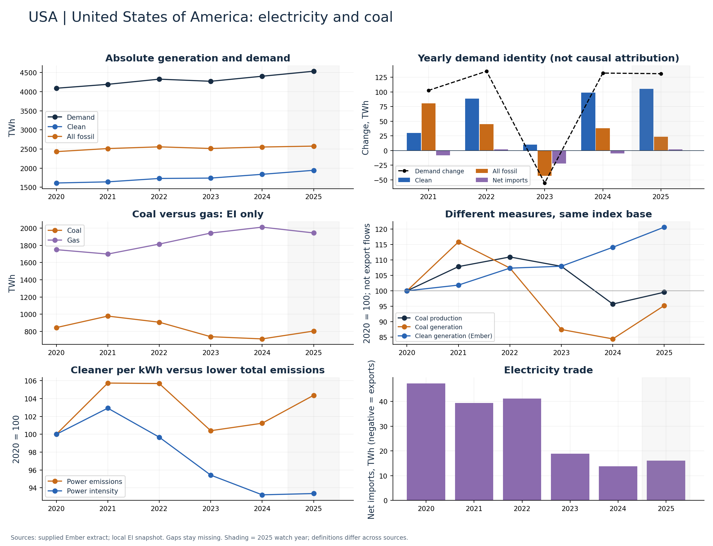

# United States of America (USA)

Coal declined through 2024, rebounded in 2025; all-fossil generation rose over 2020–2024.

Available Ember years: 2020,2021,2022,2023,2024,2025. Core research market: True.

Clean generation change: +14.1%; coal generation change: -15.6%; demand change: +7.7% (2020–2024).

Separate the coal and gas trajectories; pair the EIA national volume and price panels. Do not infer mine margins from delivered prices.

## Recommended charts

- Annual clean/fossil additions plus demand change and net imports (Ember accounting identity).
- Power emissions and carbon intensity in separate panels or clearly labelled 2020 indices.
- Coal and gas generation (EI only); clean share separately (Ember).
- Coal production and generation indices; do not infer exports or compare Mt directly with TWh.

## Evidence

|    year |   demand_twh |   clean_generation_twh |   fossil_generation_twh |   ei_coal_generation_twh |   net_imports_twh |   power_emissions_mtco2e |
|--------:|-------------:|-----------------------:|------------------------:|-------------------------:|------------------:|-------------------------:|
| 2020.00 |      4090.49 |                1611.28 |                 2431.90 |                   844.31 |             47.31 |                  1664.71 |
| 2021.00 |      4192.93 |                1641.23 |                 2512.39 |                   977.85 |             39.31 |                  1760.22 |
| 2022.00 |      4328.10 |                1729.68 |                 2557.21 |                   906.70 |             41.21 |                  1759.29 |
| 2023.00 |      4272.81 |                1739.61 |                 2514.30 |                   738.59 |             18.90 |                  1671.37 |
| 2024.00 |      4404.83 |                1838.49 |                 2552.53 |                   712.90 |             13.81 |                  1685.33 |
| 2025.00 |      4535.81 |                1943.58 |                 2576.21 |                   804.14 |             16.02 |                  1737.41 |

Sources: supplied Ember extract; local Energy Institute snapshot, joined by normalized country/year. Coal and all-fossil are different measures. No causal or security-return claim follows from these series alone.

