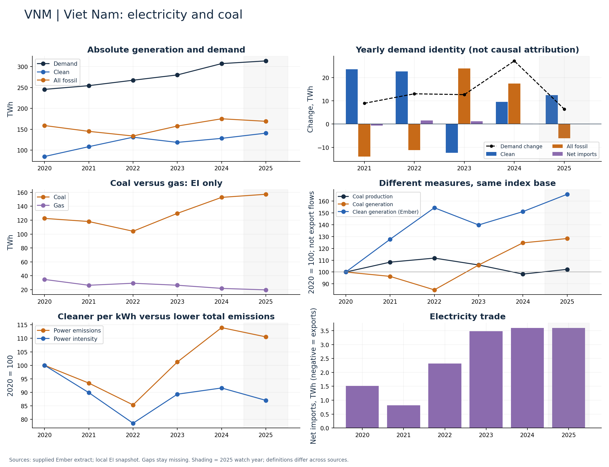

# Viet Nam (VNM)

Clean and coal generation both expanded through 2024.

Available Ember years: 2020,2021,2022,2023,2024,2025. Core research market: False.

Clean generation change: +51.1%; coal generation change: +24.7%; demand change: +25.1% (2020–2024).

Use TWh additions and 2020 indices together. Percentage clean growth does not establish absolute coal displacement in a growing electricity market.

## Recommended charts

- Annual clean/fossil additions plus demand change and net imports (Ember accounting identity).
- Power emissions and carbon intensity in separate panels or clearly labelled 2020 indices.
- Coal and gas generation (EI only); clean share separately (Ember).
- Coal production and generation indices; do not infer exports or compare Mt directly with TWh.

## Evidence

|    year |   demand_twh |   clean_generation_twh |   fossil_generation_twh |   ei_coal_generation_twh |   net_imports_twh |   power_emissions_mtco2e |
|--------:|-------------:|-----------------------:|------------------------:|-------------------------:|------------------:|-------------------------:|
| 2020.00 |       245.51 |                  84.95 |                  159.05 |                   122.53 |              1.51 |                   129.73 |
| 2021.00 |       254.43 |                 108.48 |                  145.13 |                   118.03 |              0.82 |                   121.18 |
| 2022.00 |       267.43 |                 131.13 |                  133.98 |                   104.04 |              2.32 |                   110.69 |
| 2023.00 |       280.07 |                 118.77 |                  157.82 |                   129.76 |              3.48 |                   131.30 |
| 2024.00 |       307.18 |                 128.36 |                  175.22 |                   152.78 |              3.60 |                   147.84 |
| 2025.00 |       313.60 |                 140.82 |                  169.18 |                   157.24 |              3.60 |                   143.40 |

Sources: supplied Ember extract; local Energy Institute snapshot, joined by normalized country/year. Coal and all-fossil are different measures. No causal or security-return claim follows from these series alone.

