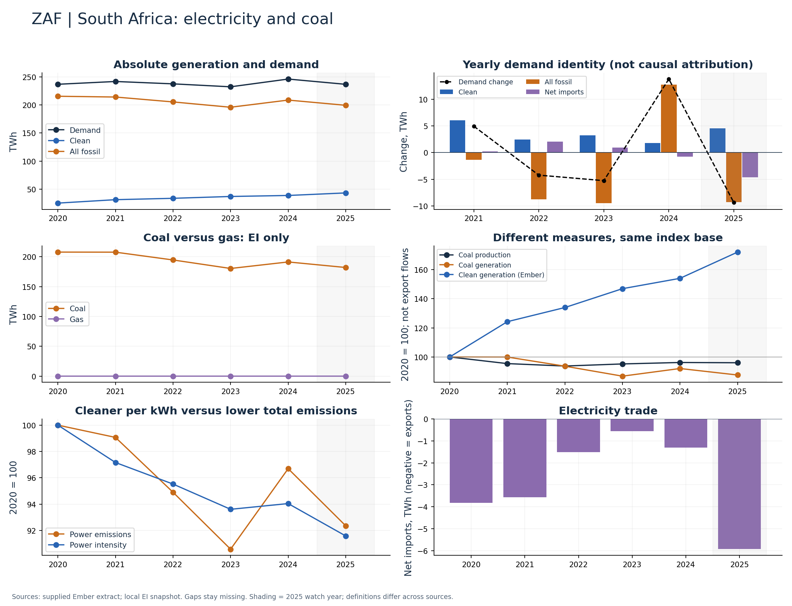

# South Africa (ZAF)

Clean generation rose from a smaller base and coal generation fell through 2024.

Available Ember years: 2020,2021,2022,2023,2024,2025. Core research market: False.

Clean generation change: +54.0%; coal generation change: -7.9%; demand change: +3.9% (2020–2024).

Show absolute generation and demand, then net imports. Output changes alone do not diagnose reliability, outages or supply adequacy.

## Recommended charts

- Annual clean/fossil additions plus demand change and net imports (Ember accounting identity).
- Power emissions and carbon intensity in separate panels or clearly labelled 2020 indices.
- Coal and gas generation (EI only); clean share separately (Ember).
- Coal production and generation indices; do not infer exports or compare Mt directly with TWh.

## Evidence

|    year |   demand_twh |   clean_generation_twh |   fossil_generation_twh |   ei_coal_generation_twh |   net_imports_twh |   power_emissions_mtco2e |
|--------:|-------------:|-----------------------:|------------------------:|-------------------------:|------------------:|-------------------------:|
| 2020.00 |       236.92 |                  25.17 |                  215.57 |                   207.82 |             -3.82 |                   183.72 |
| 2021.00 |       241.89 |                  31.27 |                  214.19 |                   207.70 |             -3.57 |                   182.01 |
| 2022.00 |       237.66 |                  33.72 |                  205.45 |                   194.64 |             -1.51 |                   174.36 |
| 2023.00 |       232.40 |                  36.98 |                  195.97 |                   180.39 |             -0.55 |                   166.42 |
| 2024.00 |       246.22 |                  38.77 |                  208.75 |                   191.31 |             -1.30 |                   177.65 |
| 2025.00 |       236.84 |                  43.31 |                  199.45 |                   182.03 |             -5.92 |                   169.68 |

Sources: supplied Ember extract; local Energy Institute snapshot, joined by normalized country/year. Coal and all-fossil are different measures. No causal or security-return claim follows from these series alone.

